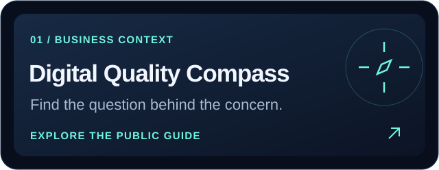
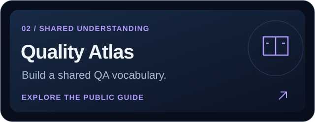
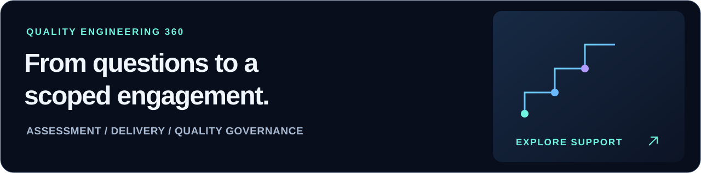

<picture>
  <source media="(max-width: 640px)" srcset="assets/platform-hero-mobile.svg" />
  
</picture>

  
  &nbsp;
  

### Quality across the full business journey

Your platforms connect through **processes, data, integrations and roles**. Your testing needs to consider those connections too.

I'm **Manoj Rollo**, Senior Digital Test Engineer / Senior Consultant at **Concept Quality Reply**, based in Turin, Italy. I work on quality and testing for **SAP, Salesforce, ServiceNow, Microsoft Dynamics 365 and custom digital platforms**, connecting requirements and test evidence to release decisions.

My background spans **11+ years in digital, including 6+ years in software testing**. Practical work includes cross-platform automation, distributed performance testing, API validation and delivery coordination, with **Selenium, Appium, JMeter and CI/CD integration**.

**QA strategy & assessment · Functional testing · API & integration testing · Web & mobile automation · Performance & load testing · AI testing · UAT & release readiness**

### Start with the question you need to answer

Public resources to make a concern clearer, align the discussion and prepare a useful next step.

| Your question | Start here | What to bring to a discussion |
| --- | --- | --- |
| Where could quality affect our business? | [**Digital Quality Compass**](https://github.com/mr-jonam/digital-quality-compass) | The business symptom, the decision it affects and the uncertainty behind it. |
| How do we build a shared understanding of QA? | [**Quality Atlas**](https://github.com/mr-jonam/quality-atlas) | A learning, onboarding or handover question. |
| How should we challenge an AI-assisted QA draft? | [**Human-First Prompts: QA & testing**](https://github.com/mr-jonam/human-first-prompts/blob/master/prompts/qa-testing.md) | Assumptions, evidence requests and points for human review. |
| What should we consider across digital platforms? | [**Digital Platform Testing Guide**](https://github.com/mr-jonam/digital-platform-testing-guide) | A platform, business journey and testing question. |

<table>
  <tr>
    <td width="50%"></td>
    <td width="50%"></td>
  </tr>
</table>

### Go deeper on your platform

Explore source-backed reading, small orientation tools and optional assistant skills. Start with one guide and identify a question worth investigating in your own context.

| Platform or concern | Public guide | Focus |
| --- | --- | --- |
| **SAP** | [SAP Testing Readiness](https://github.com/mr-jonam/sap-testing-readiness) | Business processes, roles, integrations and acceptance around a change. |
| **Salesforce** | [Salesforce Release Confidence](https://github.com/mr-jonam/salesforce-release-confidence) | Apex, configuration and business outcomes across a CRM release. |
| **ServiceNow** | [ServiceNow Testing Readiness](https://github.com/mr-jonam/servicenow-testing-readiness) | Workflow outcomes, upgrade questions and the scope of ATF evidence. |
| **Microsoft Dynamics 365** | [Dynamics 365 Testing Navigator](https://github.com/mr-jonam/dynamics-365-testing-navigator) | Application families and acceptance context before choosing testing tools. |
| **AI features** | [AI Testing Evidence Guide](https://github.com/mr-jonam/ai-testing-evidence-guide) | Acceptable behaviour, evaluation evidence, ownership and human review. |
| **Performance** | [Platform Performance Brief](https://github.com/mr-jonam/platform-performance-brief) | Workload assumptions and the limits of simple transaction-rate estimates. |
| **Web platforms & portals** | [Web Portal Quality Guide](https://github.com/mr-jonam/web-portal-quality-guide) | User journeys, identity, accessibility and cross-platform handoffs. |

**A useful starting point:** pick your platform, explore its guide and note one missing piece of evidence. The orientation materials support that discussion; decisions about a real release need evidence from the actual context.

### From a useful question to professional support

When you need context-specific evidence, interpretation or execution, we can define the appropriate scope together.

| What you need | Support to scope | Outputs to agree |
| --- | --- | --- |
| **Understand the current situation** | QA assessment across risk, coverage, dependencies and ownership. | A situation report with evidence, gaps and prioritised actions. |
| **Validate a change or release** | Functional, integration, automation, performance or AI testing for an agreed scope. | Relevant test evidence, findings and visibility of unresolved risks. |
| **Improve how quality is delivered** | Test strategy, reporting, automation reliability, quality governance and team enablement. | A prioritised improvement plan, shared criteria and responsibilities. |

These are objectives and deliverables to agree. The useful approach depends on your platform, constraints, starting evidence and delivery responsibilities.

### Bring the context. Let's scope the evidence.

**Planning a release, assessing your testing or looking for a QA delivery partner?** Message me on LinkedIn with **your platform, the planned change and the main uncertainty**. We can discuss an assessment and situation report, hands-on support or a B2B collaboration.

> We are working on [platform / business journey]. Before [decision and timing], we need to understand [testing concern or missing evidence]. Could we discuss the appropriate support?

[Explore professional support in Quality Engineering 360](https://github.com/mr-jonam/quality-engineering-360) · [Short contact brief: English / Italiano](https://github.com/mr-jonam/quality-engineering-360/blob/main/CONTACT.md) · [Technical & creative portfolio](https://github.com/MRJonam91)

Follow this profile for public QA resources and reviewed updates. Scope, outputs, availability and contracting arrangements are agreed before an engagement.

Personal professional profile. Employer and platform references do not imply endorsement. © 2026 Manoj Rollo. Original text and artwork: all rights reserved. [LICENSE](LICENSE).
