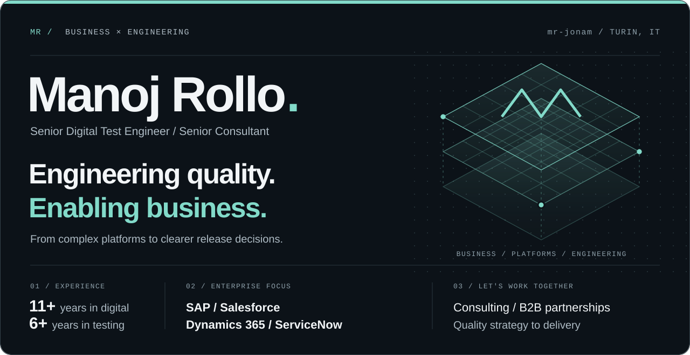
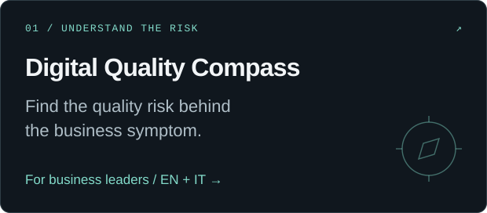
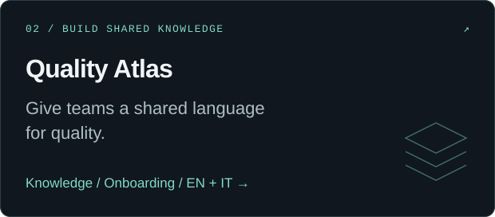
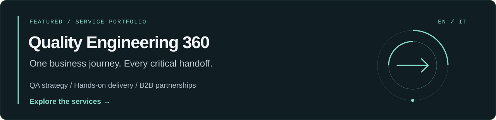

   
  <a href="https://www.linkedin.com/in/manoj-rollo/"><strong>Discuss your platform or release challenge ↗</strong></a>
  &nbsp;&nbsp; / &nbsp;&nbsp;
  <a href="#choose-a-starting-point"><strong>Find a useful starting point ↓</strong></a>

### Business context. Engineering depth.

I'm **Manoj**, a Senior Digital Test Engineer / Senior Consultant at **Concept Quality Reply**, based in Turin, Italy. I help connect the quality of digital products with the business processes, teams and decisions behind them.

My background spans **11+ years in digital**, including **6+ years in software testing**, building on earlier experience in **development, design and digital communication**. My testing work includes cross-platform automation, distributed performance testing, API validation and delivery coordination. Today, my focus includes **SAP, Salesforce, Microsoft Dynamics 365 and ServiceNow**, alongside custom web, mobile and integrated applications.

### Choose a starting point

**Understand the concern → identify the missing evidence → discuss the right support.** Start with the resource closest to your situation; you can also contact me directly without completing a guide.

<table>
  <tr>
    <td width="50%">
<strong>Make the business concern clearer.</strong> Turn a release, reporting or customer-experience symptom into questions about the next decision and the evidence missing from it. <a href="https://github.com/mr-jonam/digital-quality-compass"><strong>Explore Digital Quality Compass →</strong></a> For business and product leaders · EN / IT
</td>
    <td width="50%">
<strong>Give the team a shared QA vocabulary.</strong> Use the knowledge base to support onboarding and handovers, clarify terms and prepare more focused discussions across roles. <a href="https://github.com/mr-jonam/quality-atlas"><strong>Read Quality Atlas →</strong></a> For teams and onboarding · EN / IT
</td>
  </tr>
</table>

**Working with AI-generated output?** [Explore the QA & testing collection in Human-First Prompts →](https://github.com/mr-jonam/human-first-prompts/blob/master/prompts/qa-testing.md). Use it to make assumptions, evidence requests and human review explicit when preparing a brief. A specialist AI evaluation engagement can then be scoped around the actual system and its risks.

### Explore testing questions for your platform

The latest advisory collection combines source-backed reading, small orientation tools and optional assistant skills. Its useful result is a clearer question or discussion brief. **These eight guides are currently private previews**; request the topic that fits your situation through LinkedIn.

| Guide | What it can help you clarify |
| --- | --- |
| **Digital Platform Testing Guide** | Which platform, business journey and quality question to explore first. |
| **SAP Testing Readiness** | Process, role, integration and acceptance questions around an SAP change. |
| **ServiceNow Testing Readiness** | Workflow outcomes, upgrade questions and the scope of ATF evidence. |
| **Salesforce Release Confidence** | Questions about Apex, configuration and business outcomes across a CRM release. |
| **Dynamics 365 Testing Navigator** | Which application family and acceptance context apply before discussing RSAT or Power Apps tools. |
| **AI Testing Evidence Guide** | Acceptable behaviour, evaluation evidence, ownership and human review. |
| **Platform Performance Brief** | The demand assumptions behind average business transaction rates, with limits on what the calculation means. |
| **Web Portal Quality Guide** | Journey, identity, accessibility and cross-platform handoff questions. |

**[Request a guide preview or discuss your platform on LinkedIn ↗](https://www.linkedin.com/in/manoj-rollo/)** — mention the guide or platform and the decision ahead. Preview access and any further collaboration are agreed individually.

### Where I can help

When the questions need real evidence, interpretation or execution, we can agree a professional scope. The improvements below are objectives to discuss; the achievable outcome depends on the starting point, evidence, scope and responsibilities.

| Your challenge | Professional support to scope | Intended improvement |
| --- | --- | --- |
| A critical release is approaching, but confidence is low | Risk and coverage review, dependencies and release evidence. | Clearer release criteria, evidence gaps and decision ownership. |
| Regression is slow, automation is fragile, or performance surprises arrive late | Feedback bottlenecks, automation reliability, workload assumptions and CI/CD integration. | A prioritised improvement backlog and more relevant feedback against agreed quality targets. |
| Teams and suppliers report progress differently | Shared quality criteria, test management and reporting responsibilities. | Comparable evidence and clearer escalation paths. |
| An ERP/CRM change crosses several platforms | Business-journey validation across applications, integrations and data handoffs. | Shared coverage priorities and visibility of cross-system acceptance gaps. |
| AI features need more than a happy-path demo | Evaluation scenarios, failure cases, human review and monitoring design. | An evaluation baseline and review criteria tied to the intended use. |

**Choose the next level of support:** a focused assessment to understand the constraint, hands-on delivery support for an agreed scope, or ongoing quality governance and enablement. [Compare the engagement paths in Quality Engineering 360 →](https://github.com/mr-jonam/quality-engineering-360#choose-a-starting-point).

### Quality engineering, from strategy to delivery

**QA strategy & assessment** · **Functional & exploratory testing** · **API & integration testing** · **Web & mobile automation** · **Performance & load testing** · **UAT & release readiness** · **AI testing** · **Test management & delivery coordination**

My practical background includes **Selenium, Appium, JMeter, API testing and CI/CD integration**. I start with the business process and the delivery constraint, then select the tools and specialist support that fit.

For a wider engagement, scope and team composition are agreed around the platform, responsibilities and delivery context.

### Discuss the decision ahead

I welcome **consulting engagements, B2B delivery partnerships, collaboration with system integrators and software teams, and relevant professional opportunities**.

Start with **the platform or journey, the next decision and its timing, and the main uncertainty**. A short message is enough; you do not need a completed assessment or a chosen tool. Keep client names, credentials and internal documents out of the initial message.

**[Discuss scope and next steps on LinkedIn ↗](https://www.linkedin.com/in/manoj-rollo/)**

An initial exchange can clarify whether a focused assessment, delivery support or a B2B collaboration is the useful next step. Scope, outputs and contracting arrangements are agreed before an engagement.

[Technical & creative portfolio →](https://github.com/MRJonam91)

Personal professional profile. Scope, availability and contracting arrangements are agreed separately. Employer and platform references do not imply endorsement. © 2026 Manoj Rollo. Original text and artwork: all rights reserved. [LICENSE](LICENSE).
