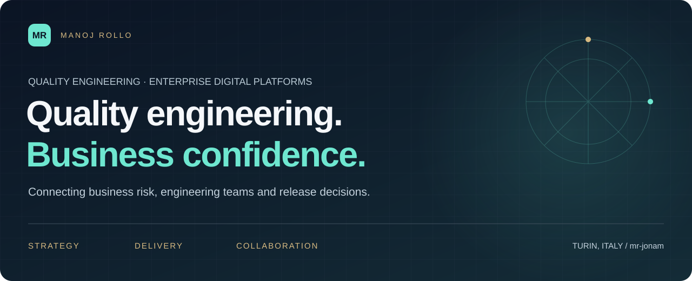
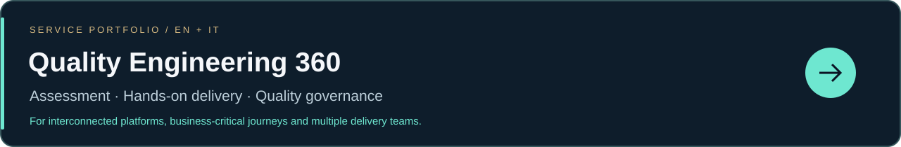

  <a href="https://www.linkedin.com/in/manoj-rollo/"><strong>Discuss a business challenge ↗</strong></a>
  &nbsp; · &nbsp;
  <a href="https://github.com/mr-jonam/quality-engineering-360"><strong>Explore QA 360 services →</strong></a>

## Connecting engineering decisions with business outcomes

I'm **Manoj Rollo**, a **Senior Digital Test Engineer / Senior Consultant at Concept Quality Reply**, based in Turin, Italy. My work connects software quality, delivery coordination and the business processes that digital platforms support.

I bring **11+ years of professional experience**, with hands-on work in test automation, distributed performance testing, API validation and cross-platform quality engineering. I work with product owners, engineering teams and delivery stakeholders to turn requirements into testable evidence and clearer release decisions.

**Current focus:** enterprise digital products and platforms, including **SAP, Salesforce, Microsoft Dynamics 365 and ServiceNow**, alongside custom applications, web, mobile and integrated services.

## Where I can help

| Your challenge | A useful conversation |
| --- | --- |
| A critical release is approaching, but confidence is low | Connect business risk, end-to-end coverage, dependencies and release evidence. |
| Regression is slow, automation is fragile, or performance surprises arrive late | Review feedback bottlenecks, test architecture, representative workloads and CI/CD integration. |
| Teams and suppliers report progress differently | Establish shared quality criteria, ownership and reporting that supports decisions. |
| An ERP/CRM change crosses several platforms | Validate the business journey across applications, integrations and data handoffs. |
| AI features need more than a happy-path demo | Define evaluation scenarios, failure cases, human review and ongoing monitoring. |

## Quality engineering, from strategy to delivery

**QA strategy & assessment** · **Functional & exploratory testing** · **API & integration testing** · **Web & mobile automation** · **Performance & load testing** · **UAT & release readiness** · **AI testing** · **Test management & delivery coordination**

My practical background includes **Selenium, Appium, JMeter, API testing and CI/CD integration**. I start with the business process and the delivery constraint, then select the tools and specialist support that fit.

For a wider engagement, scope and team composition are agreed around the platform, responsibilities and delivery context.

## Explore my work

| Resource | Why it may be useful |
| --- | --- |
| **[Quality Engineering 360](https://github.com/mr-jonam/quality-engineering-360)** · EN / IT | Services, enterprise delivery challenges, concrete outputs and collaboration models. |
| **[Digital Quality Compass](https://github.com/mr-jonam/digital-quality-compass)** · EN / IT | A starting point for business leaders: recognise quality risks and prepare a clearer brief. |
| **[Quality Atlas](https://github.com/mr-jonam/quality-atlas)** · EN / IT | QA knowledge, onboarding and knowledge transfer. |
| **[Technical & creative portfolio](https://github.com/MRJonam91)** | My broader engineering, AI and digital project work. |

## Let's talk about what needs to work

I welcome conversations about **consulting engagements, B2B delivery partnerships, collaboration with system integrators and software teams, and relevant professional opportunities**.

Start with the platform, the problem you are seeing and the decision ahead. You do not need a finished test strategy to get in touch.

**[Connect with me on LinkedIn →](https://www.linkedin.com/in/manoj-rollo/)**

Personal professional profile. Engagement scope, availability and contracting arrangements are agreed separately. Employer and platform names identify professional context; they do not imply endorsement. © 2026 Manoj Rollo. Original text and artwork: all rights reserved; see [LICENSE](LICENSE).
