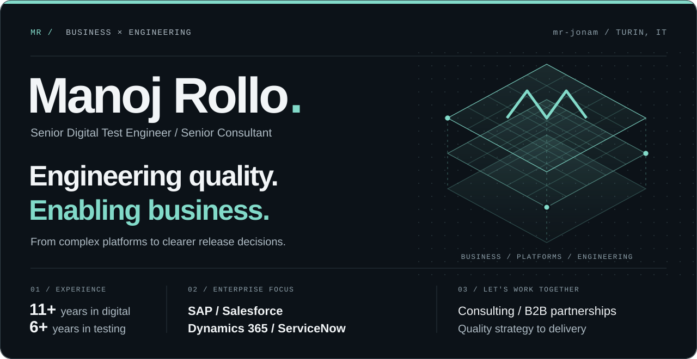
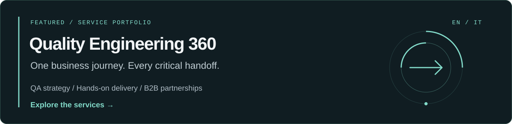
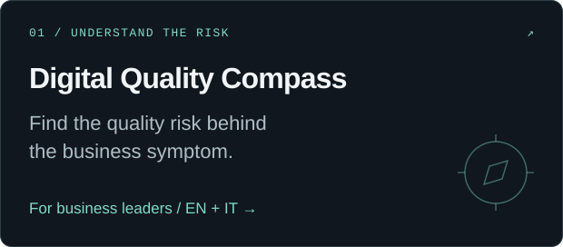
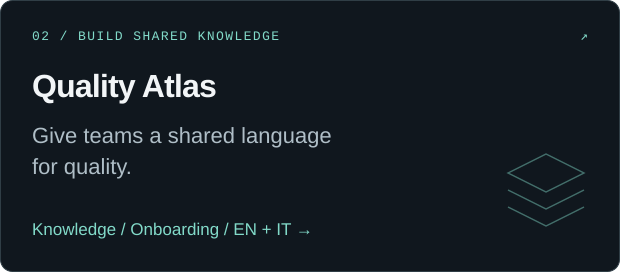

   
  <a href="https://www.linkedin.com/in/manoj-rollo/"><strong>Let's discuss your next challenge ↗</strong></a>
  &nbsp;&nbsp; / &nbsp;&nbsp;
  <a href="https://github.com/mr-jonam/quality-engineering-360"><strong>Explore QA 360 →</strong></a>

### Business context. Engineering depth.

I'm **Manoj**, a Senior Digital Test Engineer / Senior Consultant at **Concept Quality Reply**, based in Turin, Italy. I help connect the quality of digital products with the business processes, teams and decisions behind them.

My background spans **11+ years in digital**, including **6+ years in software testing**, building on earlier experience in **development, design and digital communication**. My testing work includes cross-platform automation, distributed performance testing, API validation and delivery coordination. Today, my focus includes **SAP, Salesforce, Microsoft Dynamics 365 and ServiceNow**, alongside custom web, mobile and integrated applications.

### Where I can help

| Your challenge | A useful conversation |
| --- | --- |
| A critical release is approaching, but confidence is low | Connect business risk, end-to-end coverage, dependencies and release evidence. |
| Regression is slow, automation is fragile, or performance surprises arrive late | Review feedback bottlenecks, test architecture, representative workloads and CI/CD integration. |
| Teams and suppliers report progress differently | Establish shared quality criteria, ownership and reporting that supports decisions. |
| An ERP/CRM change crosses several platforms | Validate the business journey across applications, integrations and data handoffs. |
| AI features need more than a happy-path demo | Define evaluation scenarios, failure cases, human review and ongoing monitoring. |

### Quality engineering, from strategy to delivery

**QA strategy & assessment** · **Functional & exploratory testing** · **API & integration testing** · **Web & mobile automation** · **Performance & load testing** · **UAT & release readiness** · **AI testing** · **Test management & delivery coordination**

My practical background includes **Selenium, Appium, JMeter, API testing and CI/CD integration**. I start with the business process and the delivery constraint, then select the tools and specialist support that fit.

For a wider engagement, scope and team composition are agreed around the platform, responsibilities and delivery context.

### Built to start better conversations

<table>
  <tr>
    <td width="50%">
<a href="https://github.com/mr-jonam/digital-quality-compass"><strong>Digital Quality Compass →</strong></a> Business risks · EN / IT
</td>
    <td width="50%">
<a href="https://github.com/mr-jonam/quality-atlas"><strong>Quality Atlas →</strong></a> Knowledge & onboarding · EN / IT
</td>
  </tr>
</table>

### Let's make the next move count.

I welcome **consulting engagements, B2B delivery partnerships, collaboration with system integrators and software teams, and relevant professional opportunities**.

Tell me what needs to work, where delivery gets difficult and which decision comes next.

**[Start a conversation on LinkedIn ↗](https://www.linkedin.com/in/manoj-rollo/)** &nbsp; · &nbsp; [Technical & creative portfolio](https://github.com/MRJonam91)

Personal professional profile. Scope, availability and contracting arrangements are agreed separately. Employer and platform references do not imply endorsement. © 2026 Manoj Rollo. Original text and artwork: all rights reserved. [LICENSE](../../LICENSE).
